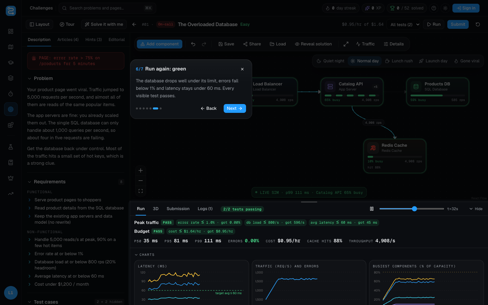
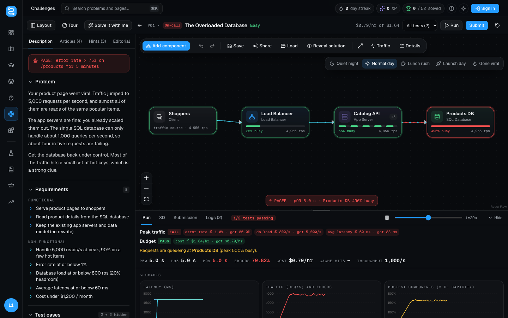
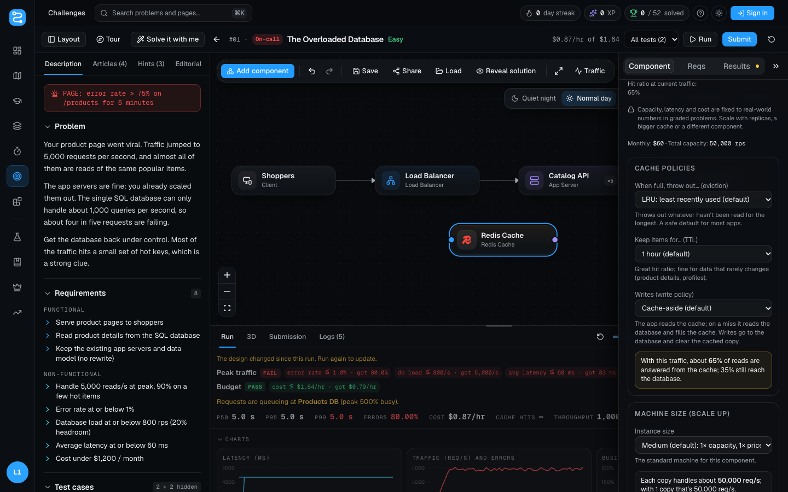
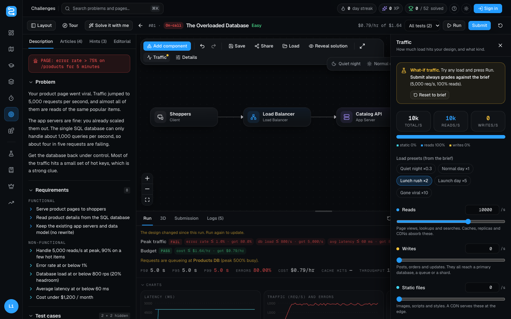
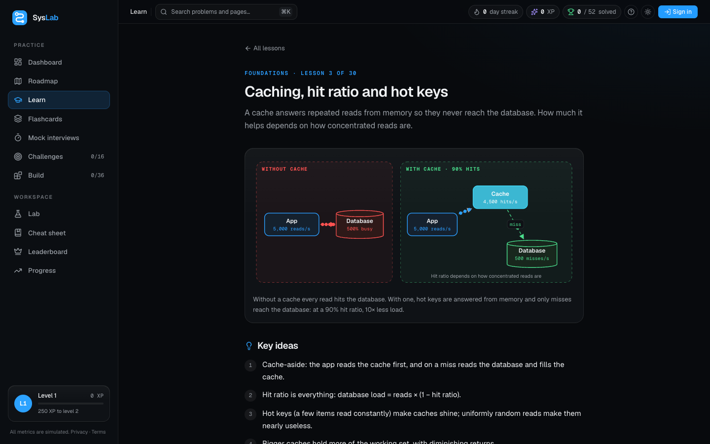

# SysLab user guide

Everything you can do in SysLab, step by step. New to system design? You don't need to know anything yet: start with the [first problem](#your-first-problem-in-5-minutes) and the tours will show you the rest.

- [The big idea](#the-big-idea)
- [Your first problem in 5 minutes](#your-first-problem-in-5-minutes)
- [The workspace](#the-workspace)
- [Adding, connecting and removing components](#adding-connecting-and-removing-components)
- [Component settings](#component-settings)
- [Traffic](#traffic)
- [Running and reading results](#running-and-reading-results)
- [Submitting and the hidden tests](#submitting-and-the-hidden-tests)
- [Getting unstuck](#getting-unstuck)
- [Learn, roadmap and flashcards](#learn-roadmap-and-flashcards)
- [Mock interviews](#mock-interviews)
- [The Lab](#the-lab)
- [Progress, accounts and the leaderboard](#progress-accounts-and-the-leaderboard)
- [Phones, tablets and themes](#phones-tablets-and-themes)
- [Keyboard shortcuts](#keyboard-shortcuts)
- [FAQ](#faq)

## The big idea

Real apps are built from a handful of building blocks: something that spreads traffic (a **load balancer**), computers running your code (**app servers**), fast memory for popular data (a **cache**), a place that stores everything (a **database**), a waiting line for slow work (a **queue**) and so on.

In SysLab you draw how these are connected, then the simulator sends traffic through your drawing, say 5,000 requests a second, and shows what happens: which parts get overloaded, how slow responses get, how many requests fail, and what it all costs. You change the design until it holds up.

## Your first problem in 5 minutes

1. Open **Challenges → The Overloaded Database** (or press **Start the first problem** on the home page).
2. A short tour points out each control. Follow it, or skip it and replay it later with **Tour**.
3. Read the red pager alert and the problem. The canvas already shows the system failing: **Products DB** is red at about 500% busy.
4. Press **Solve it with me**. SysLab builds the fix with you, step by step: it adds a cache, connects it, runs (still failing, because the cache is too small), makes the cache bigger, runs again (green).
5. Press **Submit**. Two hidden tests run too. You should see **Accepted**.

Now try the next problem on your own.

## The workspace

| Area | What it's for |
| --- | --- |
| **Header** | Problem name and difficulty, live cost per hour against the budget, **Run**, **Submit**, reset, **Tour** and (on the first challenge) **Solve it with me**. **Layout** hides the problem panel for a bigger canvas. |
| **Problem panel** (left) | *Description* (scenario, functional and non-functional requirements, back-of-envelope numbers, test cases), *Articles* (lessons this problem uses), *Hints* (revealed one at a time), *Editorial*, *Submissions*. |
| **Canvas** (centre) | Your design. The toolbar has **Add component**, undo/redo, save/share/load, reveal solution, full screen, **Traffic** and **Details**. The scenario bar (top right) switches the load. |
| **Run console** (bottom) | Appears after a run: tests, latency/traffic/busy charts, a components table, what to fix, logs, a **3D** view and your submissions. Drag its top edge to resize it. |

On a phone the workspace has three views: **Problem**, **Design** and **Results**.

## Adding, connecting and removing components

| To… | Do this |
| --- | --- |
| **Add** | **Add component** → click a component (it lands in the middle of the canvas), or drag it to a spot. Search by name: "redis", "kafka", "postgres". |
| **Connect** | Drag from a component's **right dot** (traffic out) to another's **left dot** (traffic in). Or double-click a component and use **Send traffic to**. |
| **Open settings** | Double-click a component. |
| **Move** | Drag it. |
| **Rename** | Double-click its name. |
| **Remove a component** | Click it and press **Delete** (or Backspace), or use **Delete component** in its settings. |
| **Remove a connection** | Double-click the arrow. |
| **Undo / redo** | ⌘Z / ⇧⌘Z (Ctrl on Windows), or the toolbar arrows. |

## Component settings

Double-click any component. At the top, **In plain words** explains what it is with an everyday comparison, when to use it, the terms you'll see and what to watch out for ([full reference](components.md)).

Below that are the settings. In graded problems, capacity, latency and price per replica are fixed to realistic numbers; you scale by choosing components and their settings:

| Component | Settings |
| --- | --- |
| Every component | **Replicas** (identical copies: more capacity, and survive one failing) |
| App servers, serverless, workers, WebSocket gateways | **Machine size** (scale up), **Autoscaling** with a maximum, **Request timeout** (app servers and serverless) |
| Cache | **Cache size**, **Eviction** (LRU, LFU, FIFO, random), **TTL**, **Write policy** (cache-aside, write-through, write-back), machine size. A live readout shows the hit ratio. |
| Databases | **Max connections**, **Indexed columns** (or index level), machine size, **Read consistency** (NoSQL) |
| Load balancer | **Algorithm** (round robin, least connections, IP hash, random), **Health checks** |
| CDN | **How long files stay at the edge** (TTL) |

Every option shows a one-line consequence, and most have a live readout. What each setting does in the simulation is documented in [simulator.md](simulator.md#component-settings).

## Traffic

The **scenario bar** on the canvas switches the load in one click: **Quiet night** (×0.3), **Normal day** (×1), **Lunch rush** (×2), **Launch day** (×5), **Gone viral** (×10).

**Traffic** opens the full panel:

- **Reads, writes and static files per second**, each with a slider and a number;
- **Hot keys**: how many reads go to a few popular items (caches love this);
- **Contended writes**: writes racing for the same item (needs a lock);
- **AI requests**: requests that call a model.

On problem pages this is a **what-if**: try any load and press Run, but **Submit always grades against the problem's own traffic**. **Reset to brief** puts it back.

## Running and reading results

**Run** pushes 60 seconds of traffic through your design: it ramps up, then holds at peak. While it replays, components show how busy they are and arrows show requests flowing (red dots are failures).

In the console:

- **Test lines**: each test passes or fails, with the numbers (for example "error rate ≤ 1% · got 14.8%").
- **What to fix**: the busiest component and why requests fail.
- **p50 / p95 / p99**: the latency half of users, 95% of users and 99% of users get. p99 is what your unluckiest users feel.
- **Errors, cost, cache hits, throughput.**
- **Charts**: latency, traffic and errors, and the busiest components over the 60 seconds. Drag the timeline to replay.
- **3D**: your design as towers. Height is load and colour is health.

## Submitting and the hidden tests

**Submit** grades every visible test plus two hidden ones:

| Hidden test | What it does | Pass if |
| --- | --- | --- |
| **Viral spike** | 30% more traffic | errors ≤ 5% |
| **Cache restart** | Fewer reads hit the cache (cold cache) | errors ≤ 20% |

A hidden test is revealed if it fails. Pass everything to **solve** the problem: you earn your score as XP, plus 50 XP the first time. If you're signed in, the server re-runs your design to verify the score for the leaderboard.

Your score (0–100) combines **performance** (errors and latency), **reliability** (no single points of failure, survives losing a component), **cost** (within budget) and **architecture** (uses what the requirements ask for).

## Getting unstuck

- **Tour**: replays the workspace tour, with animations of every gesture.
- **Solve it with me**: a guided, live solve of the first challenge.
- **Articles**: the lessons this problem relies on.
- **Hints**: three per problem, increasingly specific.
- **Editorial**: the reasoning behind a good answer.
- **Reveal solution**: loads the reference design (it's graded but earns no XP until you change something).

## Learn, roadmap and flashcards

- **Learn**: 30 lessons in six stages. Each has an animated diagram, key ideas, "under the hood" sections, a worked example with numbers, a trade-offs table, common mistakes, interview tips and related problems.
- **Roadmap**: the learning path, stage by stage, with the lessons to read first and the problems to practise. Each stage ends in a checkpoint problem.
- **Flashcards**: 73 cards. You see up to 10 new cards a day; cards you know come back after 1, 3, 7, 16 and 35 days.
- **Cheat sheet**: latency numbers, formulas, component capacities and availability "nines".

## Mock interviews

Eight 45-minute interviews (E4 to E6 level). You write requirements, estimate peak traffic and read share, design on the canvas, then a **twist** arrives at minute 30 (more traffic, a smaller budget, or a failure). The scorecard weighs requirements 15%, estimation 15%, design 40%, twist 20% and time 10%, and maps your total to E4/E5/E6.

## The Lab

A free canvas with no problem attached. Everything is editable, including capacity, latency and cost, so you can model anything. Use **Save** for named designs and **Share** for a read-only link anyone can open and copy.

## Progress, accounts and the leaderboard

Without an account, progress (scores, XP, streak, designs, flashcards) is saved in your browser. **Progress** can export it all to a file and import it elsewhere.

Signing in (Google, GitHub, email link or email and password) syncs everything across devices. Your browser's guest progress moves into your account the first time. You also get a **public profile** (streak calendar, solved problems, learning path) and a place on the **leaderboard**, which counts only scores verified on the server.

## Phones, tablets and themes

- **Phones:** a bottom tab bar (Home, Learn, Build, Challenges, Progress); the workspace switches between Problem, Design and Results.
- **Tablets:** a slim icon sidebar.
- **Touch screens:** connection dots are always visible and bigger.
- **Theme:** the sun/moon button switches between dark and light.
- **Help:** the **?** button replays the site tour.

## Keyboard shortcuts

| Keys | Action |
| --- | --- |
| ⌘K / Ctrl+K | Search problems and pages |
| ⌘↵ / Ctrl+Enter | Run |
| ⌘Z, ⇧⌘Z | Undo, redo |
| Delete / Backspace | Remove the selected component or connection |
| ← → | Previous / next tour step |
| Esc | Close a tour, drawer or dialog |

## FAQ

**Is it free?** Yes, everything.

**Are the numbers real?** They come from a simple, documented model (capacity, queueing, cache hit ratios, replicas, failures), tuned to realistic orders of magnitude. Good for learning trade-offs, not for capacity-planning real hardware.

**Why can't I change capacity or cost in a problem?** So scores are comparable and can't be gamed. Scale with replicas, bigger machines, caches and better architecture instead. In the Lab everything is editable.

**My score didn't show on the leaderboard.** Only scores verified by the server count. Sign in and submit again.
